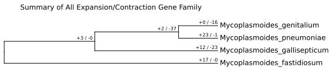
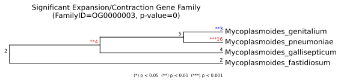
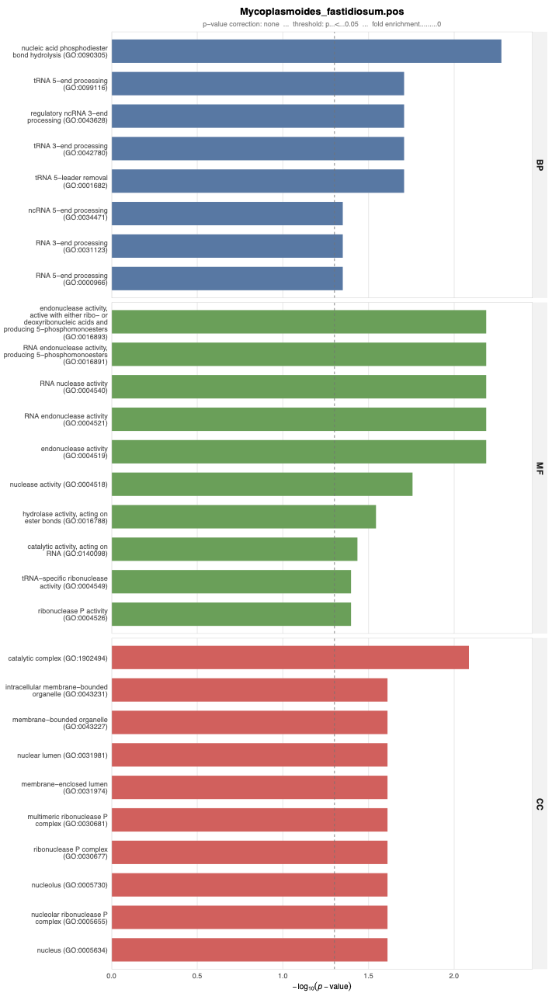
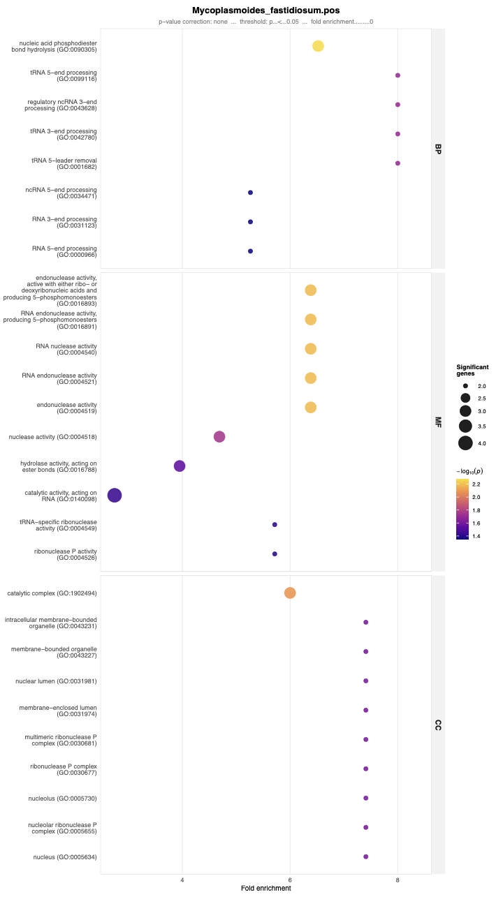

# EXCON Output Guide

This page describes the key outputs produced by the EXCON pipeline, with example figures from a test run on four *Mycoplasmoides* bacterial species.

To replicate this you run:

`nextflow run main.nf -profile docker,test_bacteria,mac -bg --orthofinder_v2 --predownloaded_gofiles data/mycoplasma_go_files -resume`

---

## Output Directory Structure

```
results/
├── cafe/                    # CAFE5 model fitting and selection
├── cafe_plot/               # Expansion/contraction visualisations
├── cafe_go/                 # GO enrichment results and plots
├── chromo_go/               # [optional] GO enrichment by chromosome (!won't work for mycoplasma!, only one chr)
├── eggnogmapper/            # [optional] EggNOG GO annotations
├── proteomes/               # Per-species proteomes (the gene IDs used throughout)
├── orthofinder_cafe/        # OrthoFinder species tree and orthogroups
├── species_tree/            # [optional, --iqtree_species_tree] IQ-TREE2 species tree
├── busco/                   # [optional, --stats] BUSCO completeness
├── agat/                    # [optional, --stats] Annotation statistics
├── quast/                   # [optional, --stats] Assembly statistics
└── pipeline_info/           # Execution reports, DAG, software versions
```

---

## CAFE Expansion/Contraction Plots (`results/cafe_plot/`)

All tree figures are published in PDF and SVG formats. SVG files are suitable for editing in Inkscape.

### Summary Tree (cafeplotter)

Produced by [CAFEPlotter](https://github.com/moshi4/CafePlotter) from the best-fitting CAFE5 model. Shows the **total** number of expanded (+) and contracted (−) gene families per branch, **without a p-value filter**.



*Example: four* Mycoplasmoides *species. Numbers on each branch show all expanded/contracted gene family counts. Internal nodes represent ancestral lineages.*

---

### Significant HOG Tree (`cafe_sig_hog_tree.pdf/svg`)

Same layout as the cafeplotter summary tree but restricted to **statistically significant** gene families only: family-wide p ≤ `--cafe_family_pvalue` and branch p ≤ `--cafe_branch_pvalue` (both 0.05 by default). Each leaf and internal node is annotated with `+expanded / −contracted` counts from `CAFE_summary.txt`. This is the figure to use when reporting how many families changed significantly on each lineage.

---

### Significant Gene Tree (`cafe_sig_gene_tree.pdf/svg`)

Shows the **net number of genes** gained or lost on each branch, summed across the significant families only. A family that contracted from 10 to 7 genes contributes −3, regardless of how many other genes it still contains. Use this figure to compare the magnitude of gene gain/loss, not just family counts.

> Note: both alternative tree figures are produced only when GO enrichment analysis is run (they depend on `CAFE_summary.txt` generated during that step).

---

### Node Number Guide (`cafe_node_label_guide.pdf/svg`)

Maps the internal node numbers used in `CAFE_summary.txt` (e.g. node 14, 15) to their positions on the species tree. Useful for interpreting which ancestral lineage a node refers to.

---

### Individual Gene Family Trees

For each significantly evolving orthogroup, a tree shows the gene count at each node with colour-coded significance: red = expansion, blue = contraction. Asterisks indicate significance level (* p<0.05, ** p<0.01, *** p<0.001).



*Example: OG0000003 — massive expansion in* M. pneumoniae *(+16 genes, ***) and contraction in* M. genitalium *(−3 genes, **), consistent with genome size differences in this clade.*

---

## GO Enrichment Plots (`results/cafe_go/`)

GO enrichment is run per species per direction (expanded/contracted gene families). Two publication-quality plot types are produced for each.

### Bar Plot

Terms are grouped by ontology (CC / MF / BP), sorted by significance, and coloured by category. Full GO term names are retrieved from `GO.db` — topGO's internal truncation is bypassed. The GO ID is shown below each term.



*Example: expanded gene families in* Mycoplasmoides fastidiosum. *X-axis: −log₁₀(p-value). Colour: ontology (blue = CC, green = MF, red = BP). Dashed line: significance threshold.*

---

### Dot Plot

The dot plot adds two extra dimensions: dot **size** encodes the number of significantly expanded/contracted genes annotated to that term, and dot **colour** (plasma gradient) encodes −log₁₀(p-value). X-axis shows fold enrichment, making it easy to distinguish highly significant but modestly enriched terms from strongly enriched terms with fewer genes.



*Example: expanded gene families in* Mycoplasmoides fastidiosum. *X-axis: fold enrichment. Dot size: significant gene count. Dot colour: −log₁₀(p-value), yellow (less significant) → purple (more significant).*

---

### Output Files

| File | Where | Description |
|------|-------|-------------|
| `*_TopGo_results_ALL.tab` | `cafe_go/<go_algo>_cutoff<go_cutoff>_type<go_type>/topgo_results/` | topGO results for each species/node and direction: every term with raw P below the cutoff, with all P-value corrections (over every term tested) and fold enrichment |
| `*.pos.txt`, `*.neg.txt`, `*.BK.txt.uniq` | `cafe_go/…/go_inputs/` | The expanded/contracted families tested, and the background: the families CAFE5 modelled that contain the species |
| `TopGO_barplot_*.pdf` | `cafe_go_summary/cafe_go/raw_plotting_files/cafe_go_{pos,neg}.tar.gz` | Horizontal bar chart (ggplot2) |
| `TopGO_dotplot_*.pdf` | as above | Dot plot with fold enrichment and gene count (ggplot2) |
| `TopGO_Pval_barplot_*.pdf` | as above | Legacy bar chart (base R, retained for compatibility) |

The cross-species summaries and heatmaps are in `cafe_go_summary/cafe_go/`. Large-family results go to the matching `cafe_go_large/` and `cafe_go_summary/cafe_go_large/` folders.

---

## CAFE Summary Table (`results/cafe_go/.../CAFE_summary.txt`)

A tab-separated table with one row per species (leaf) and per internal node, produced during the GO enrichment step. The file is self-documenting — the first lines are comment lines (`#`) that define each column.

| Column | Description |
|--------|-------------|
| `Species/Node` | Leaf species name or ancestral node number (matches `cafe_node_label_guide.pdf`) |
| `Total_HOGs_significant` | Gene families significant on this branch: family-wide p ≤ `--cafe_family_pvalue` and branch p ≤ `--cafe_branch_pvalue` (both 0.05 by default) |
| `Expansion_HOGs_significant` | Significant families with a net positive size change |
| `Contraction_HOGs_significant` | Significant families with a net negative size change |
| `Expansion_genes_significant` | Sum of gene count increases across all significant expanding families |
| `Contraction_genes_significant` | Sum of gene count decreases across all significant contracting families (reported as negative) |
| `Expansion_HOGs_total` | All families with any positive size change, regardless of significance |
| `Contraction_HOGs_total` | All families with any negative size change, regardless of significance |

> The `*_total` columns match what cafeplotter displays on the standard summary tree. The `*_significant` columns are what the alternative tree figures (`cafe_sig_hog_tree`, `cafe_sig_gene_tree`) use.

---

## CAFE Model Selection (`results/cafe/model_comparison/`)

| File | Description |
|------|-------------|
| `cafe_model_parameters.tsv` | The fitted parameters of every model compared (k = 1 to `--cafe_max_k` with a uniform root, and the best k with a Poisson root): k, root distribution, Poisson root mean, λ, α (k > 1), the error model's ε, -lnL, CAFE5's largest allowed λ for the tree, and `BEST` for the selected model |
| `model_selection.tsv` | -lnL, AIC and BIC for k = 1 to `--cafe_max_k` rate categories (uniform root); the best k by AIC. `Note` reads `best_k_at_cafe_max_k` when the best k is the largest tested |
| `k_boundary_warning.txt` | Written only when the best k is the largest tested: a larger `--cafe_max_k` may fit better |
| `best_k.txt` | That k |
| `cafe_model_comparison.tsv` | Uniform vs Poisson root at the best k: parameters, -lnL, AIC, BIC, number of families; selected by AIC |
| `best_model.txt` | Selected model: `uniform` or `poisson`. Its CAFE5 output is in `results/cafe/best/` |
| `root_split_warning.txt` | Only when one species is alone on one side of the root: the two branches next to the root, whose expansions/contractions mostly reflect the root-size prior |
| `families_not_modelled.tsv` | Only when CAFE5 dropped families for having no genes on one side of the root: which ones (`--cafe_zero_root` fits them) |
| `root_filter_warning.txt` | How many families that was |

Families left out of the main run for their size (`max_copies_ge_<N>` for `--cafe_max_copies` N, default 100, or `differential_gt_threshold` in `results/cafe/base/hog_filtering_report.tsv`) are fitted one at a time, with λ fixed to the main families' estimate (`--cafe_large_mode fixed`, default) or each with its own (`per_family`); their counts and merged results are in `results/cafe/large_families/`, with `large_families.txt` saying how many there were (or that there were none), and the run log says how many were fitted.

---

## Significant Families (`results/cafe/significant_families/`)

A family changes significantly on a branch when **both** its family-wide p-value (CAFE5's `*_family_results.txt`) is at most `--cafe_family_pvalue` **and** that branch's p-value (`*_branch_probabilities.tab`) is at most `--cafe_branch_pvalue`. Both default to 0.05. This follows CAFE5, which gives branch p-values only for families significant overall. The same rule is used for these tables, the CAFE GO gene lists, `CAFE_summary.txt` and the significant-family tree figures.

| File | Description |
|------|-------------|
| `changes_per_node.tsv` | Every branch where a family's size changed, from the main model |
| `significant_changes_per_node.tsv` | The rows that pass both cutoffs |
| `combined_changes_per_node.tsv` | Both tables' rows for the main model and the large-family track, with a `source` column |
| `combined_significant_changes_per_node.tsv` | The rows of that table that pass both cutoffs |

Columns of `changes_per_node.tsv`: `Node` (species, or the CAFE5 node id from `cafe_node_label_guide.pdf`), `HOG`, `change` (gene count change on that branch), `family_pvalue`, `branch_pvalue`, `direction` (`expansion` / `contraction`), `family_significant`, `branch_significant` and `significant` (both). The significant-only tables keep the first six. Before v2.5.2 the branch p-value column was called `pvalue`, there was no family p-value, and only the branch p-value was tested, against `--go_cutoff`.

---

## Zero-root Sensitivity Run (`results/cafe/zero_root/`, with `--cafe_zero_root`)

The main model drops families with no genes on one side of the root, as CAFE5 does by default (listed in `cafe/model_comparison/families_not_modelled.tsv`). With `--cafe_zero_root`, just those families are fitted again with CAFE5's `-z`, which allows a family size of zero at the root, with λ fixed to the main families' estimate and the same error model. These results are a sensitivity analysis: CAFE5 doesn't recommend `-z` in general, because these families' root sizes, and so their changes near the root, are poorly determined. They are never merged into the main results.

| File | Description |
|------|-------------|
| `zero_root_counts.tsv` | The gene counts of the families fitted |
| `Out_cafe_zero_root/` | CAFE5's output for them |
| `cafe_zero_root.log` | CAFE5's log |
| `significant_families/` | `changes_per_node.tsv` and `significant_changes_per_node.tsv` for these families, with the same cutoffs as the main model |

---

## CAFE Family Status (`results/cafe/cafe_family_status.tsv`)

One row per gene family in the orthogroup table, saying what became of it. The run log prints the count for each status.

| Column | Description |
|--------|-------------|
| `HOG` | Family ID |
| `status` | What became of it (below) |
| `track` | `main` (the main CAFE5 model), `large` (the large-family track) or `none` (not given to CAFE5) |
| `prep_filter` | `exclusion_reason` from `cafe/base/hog_filtering_report.tsv`: `retained`, `single_species`, `empty_after_subset`, `max_copies_ge_<N>` (`--cafe_max_copies`, default 100) or `differential_gt_threshold` |
| `n_species_present`, `n_max`, `n_min`, `total_genes`, `differential` | Copied from `hog_filtering_report.tsv` |

| `status` | Meaning |
|----------|---------|
| `modelled` | In the selected main model (`cafe/best/`) |
| `modelled_large` | Fitted by the large-family track |
| `excluded_single_species` | Genes in one species only, so there is nothing to model |
| `excluded_empty_after_subset` | No genes in the species analysed (`--cafe_clade` / `--cafe_species`) |
| `not_present_at_root` | No genes on one side of the root, so CAFE5 dropped it from the main model (`--cafe_zero_root` fits these separately, in `cafe/zero_root/`) |
| `large_not_present_at_root` | The same, in the large-family track |
| `large_did_not_converge` | The large-family fit has no finite likelihood (at the fixed λ, or with its own λ in `per_family` mode) |
| `large_task_failed` | The large-family task failed on every attempt (e.g. ran out of time) |
| `not_in_results` | Given to CAFE5 but missing from its results for another reason |

---

## Proteomes (`results/proteomes/`)

The `*.clean.fasta` files written by `RENAME_FASTA`, one per species. These hold the exact
sequences given to OrthoFinder, and their headers are the gene IDs that appear throughout
`Orthogroups.tsv`, `N0.tsv` and the CAFE outputs.

They are published because reusing a finished analysis needs them: `--proteome_dir` takes this
directory. If a run predates this being published, or its work directory has been deleted, both
`bin/proteomes_from_orthofinder.py` and `bin/rename_fasta_standalone.py` rebuild them exactly
from published output.

---

## IQ-TREE2 Species Tree (`results/species_tree/`)

Produced only when `--iqtree_species_tree` is set. The species tree passed to CAFE5 is then
this tree rather than the OrthoFinder one in `results/orthofinder_cafe/`.

| File | Description |
|------|-------------|
| `SpeciesTree_rooted.nwk` | The rooted tree actually used for CAFE5 |
| `iqtree/species_tree.treefile` | Unrooted ML tree, with SH-aLRT and ultrafast bootstrap support at each node |
| `iqtree/species_tree.iqtree` | Full IQ-TREE2 report, including the substitution model selected for each partition |
| `iqtree/species_tree.log` | IQ-TREE2 run log |
| `supermatrix/supermatrix.faa` | Concatenated single-copy orthogroup alignment, one sequence per species |
| `supermatrix/partitions.txt` | Partition boundaries in the supermatrix, one per orthogroup |

With `--tree_calibrations`, the same directory also holds the time-calibrated tree, dated with `ape::chronos` or, with `--dating_method lsd2`, IQ-TREE's LSD2:

| File | Description |
|------|-------------|
| `SpeciesTree_dated.nwk` | Ultrametric tree with branch lengths in millions of years — the tree CAFE5 receives |
| `dating_calibrations.tsv` | Each calibration, the node it resolved to, and the age actually fitted |
| `dating_qc.tsv` | Model settings, root age, shortest branch, ultrametric/binary checks |
| `lsd2/dated.timetree.nex`, `lsd2/dated.timetree.lsd`, `lsd2/dated.log` | With `--dating_method lsd2`: IQ-TREE's time tree (NEXUS, branch lengths in time units), LSD2 report and run log |

With `--cafe_clade` or `--cafe_species`, the pruned tree actually given to CAFE5:

| File | Description |
|------|-------------|
| `SpeciesTree_pruned.nwk` | The tree restricted to the selected clade or species |
| `pruned_tree_species.tsv` | Every species in the full tree, flagged as retained or dropped |

When this tree is used, CAFE5's λ is a rate per million years. Without it, λ is in units of the
(rescaled) substitution tree and is not comparable to published per-Myr rates.

Support values are given as `SH-aLRT/UFboot`. As a rule of thumb a branch is well supported when
SH-aLRT ≥ 80 and UFboot ≥ 95; treat anything below that as unresolved rather than as evidence for
the displayed topology.

Check the `CONCAT_SINGLE_COPY` log (or the task's `.command.out`) for how many orthogroups made it
into the supermatrix. Only orthogroups present exactly once in every species are used, so the
count can fall sharply as species are added or if any annotation is fragmented.

---

## Pipeline Metadata (`results/pipeline_info/`)

| File | Description |
|------|-------------|
| `execution_report_*.html` | Per-process resource usage summary |
| `execution_timeline_*.html` | Gantt-style timeline of all tasks |
| `execution_trace_*.txt` | Raw per-task CPU/memory/time trace |
| `pipeline_dag_*.html` | Interactive pipeline DAG |
| `software_versions.yml` | Exact versions of all tools used (cite from here) |
